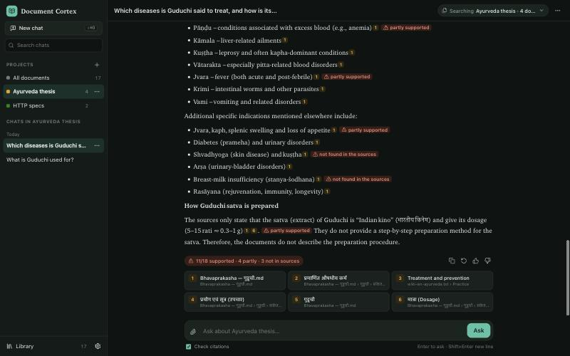
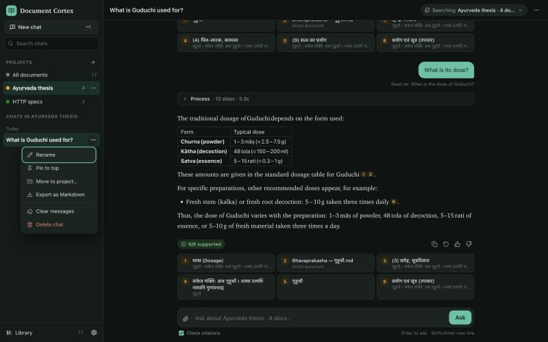
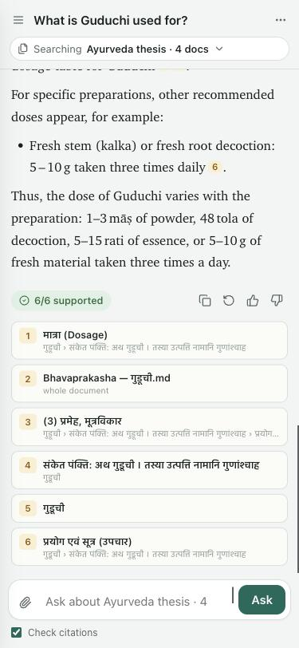
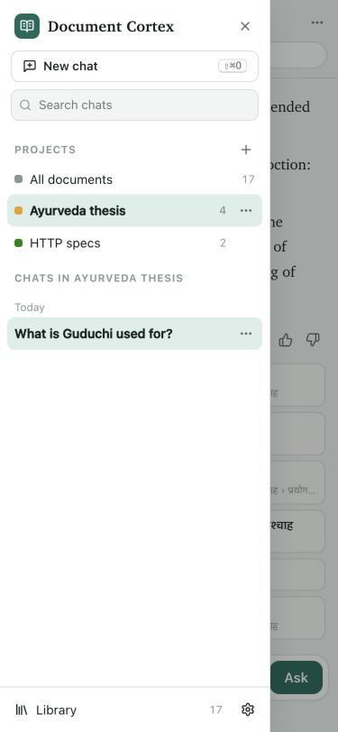
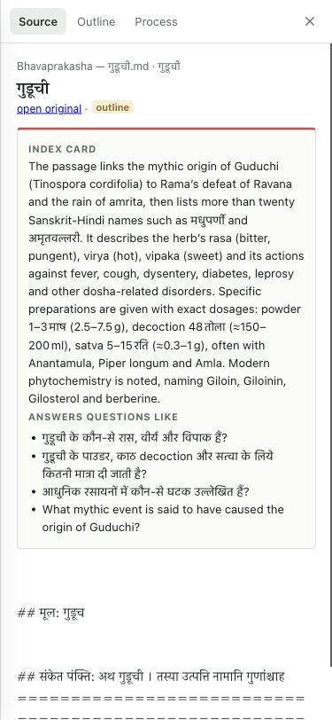

# Web UI: design notes

What a person does with Document Cortex, in order of frequency:

1. Ask a question about documents they already added, and check the answer.
2. Come back to an earlier conversation.
3. Add documents and keep them organised.
4. Narrow a question to some documents (one book, one project).
5. Change a setting, or see why something failed.

The layout follows that order: conversations are always one click away, the library is a
separate view, and settings sit at the bottom of the sidebar.

## Concepts

| Thing | What it is | Where it lives |
|---|---|---|
| **Document** | One file in the library, with its outline, cards and index | `~/.cortex/docs/<slug>/` |
| **Folder** | A label on a document for tidying the library (`Ayurveda/Nighantu`) | the document's `meta.json` |
| **Project** | A named set of documents plus the chats about them ("Ayurveda thesis", "HTTP specs") | `~/.cortex/projects.json` |
| **Chat** | A conversation: questions, answers with sources, checks and process steps | `~/.cortex/chats/<id>.json` |

A document can be in several projects; a folder is only for the library view. A chat belongs to
at most one project and searches that project's documents unless its scope is changed.

## Layout

```
┌ Sidebar (272px) ─────┐┌ Header: ☰ · chat title (rename) · scope ▾ · ⋯ ─────┐┌ Panel (420px) ─┐
│ Document Cortex      ││                                                   ││ Source │Outline│
│ [+ New chat]   ⌘⇧O   ││   question                                        ││ │Process       │
│ Search chats   ⌘K    ││   ▸ Process · 7 steps · 2.4s                      ││                │
│ PROJECTS          +  ││   answer with [1] [2] citations                   ││ section text,  │
│  ● All documents     ││   ✓ 4/4 supported · 👍 👎 · Copy · Retry          ││ index card,    │
│  ● Ayurveda thesis   ││   [1] Bhavaprakasha › Guduchi › Dose  p. 12       ││ outline tree,  │
│ CHATS                ││                                                   ││ ingest steps   │
│  Pinned / Today /    ││                                                   ││                │
│  Previous 7 days /   │├───────────────────────────────────────────────────┤│                │
│  Older               ││ [📎] Ask about Ayurveda thesis (4 documents)… [Ask]││                │
│ 📚 Library  ⚙ Settings││ ☑ Check citations                                 ││                │
└──────────────────────┘└───────────────────────────────────────────────────┘└────────────────┘
```

- **Phone (< 768px):** the sidebar is a drawer behind ☰; the panel opens full screen; the composer
  stays at the bottom above the keyboard; the library table becomes cards.
- **Tablet (768–1100px):** the panel overlays the conversation instead of squeezing it.

## Features

**Chats**
- New chat (button, `Ctrl/⌘ ⇧ O`); the first question becomes the title; rename inline.
- Chat menu: rename, pin, move to project, export as Markdown, **clear messages**, delete.
  Clear and delete can be undone for 5 seconds from the toast.
- Search chats by title (`Ctrl/⌘ K`); grouped as Pinned, Today, Previous 7 days, Older.
- Follow-up questions work: "what is its dose?" is rewritten with the chat's earlier turns
  before searching, and the process trace shows the rewritten question.
- Per answer: copy, 👍/👎, retry (asks again, replacing the answer), sources, process.
- Stop a running answer.

**Scope**
- The header chip shows what the chat searches: all documents, a project, or a hand-picked set.
  It opens a checklist grouped by folder.

**Projects**
- Create from the sidebar (name + documents). Edit documents, rename or delete from its menu.
  Deleting a project keeps its chats and documents.
- The empty state of a project chat suggests questions taken from its documents' index cards.

**Library**
- Upload by drop or button; live progress for each document.
- Search, filter by folder or status. Folders are created by typing a name when moving a document.
- Per document: ask about it, outline, processing steps, add to project, move to folder,
  rename, download the original, remove.
- Select several to add them to a project or ask about them together.

**Settings**
- Theme (system, light, dark), citation check on by default, API keys found (read-only, with
  where to put them), data folder, models used, "Learn from 👍 answers", keyboard shortcuts.

## States

- No documents: the main area explains what to add and opens the file picker.
- A document still processing: progress bar and current step in the library and the scope list;
  it cannot be selected until ready.
- No API key: a banner with the exact file to edit.
- Errors show in place, in words, with what to do next.

## Screenshots

| | |
|---|---|
|  |  |
|  |  |
|  | |

Icons: [Lucide](https://lucide.dev) v0.460.0 (ISC licence), embedded in the page so the app works offline.
